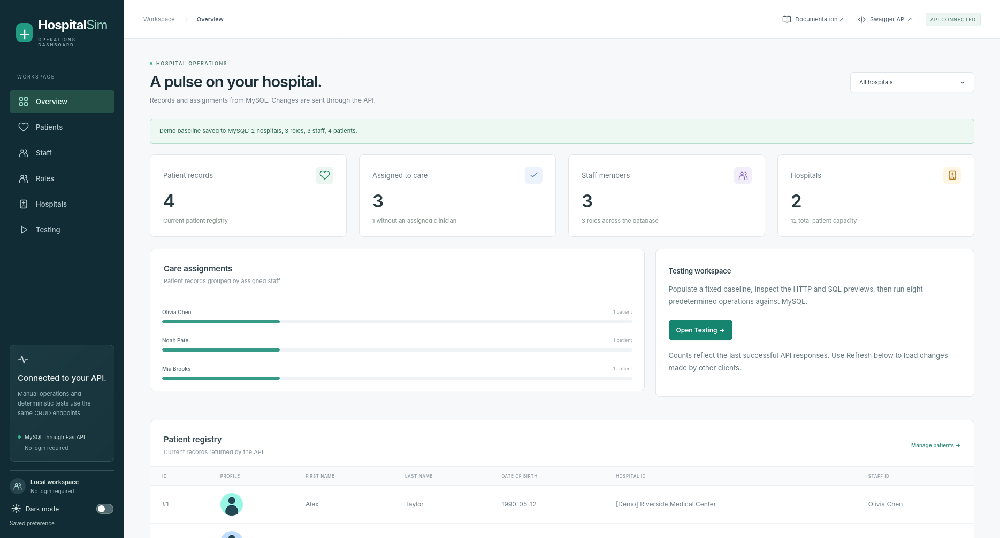
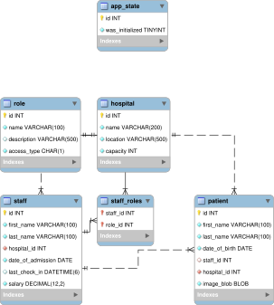

# HospitalSim 

A no-login hospital dashboard backed by FastAPI and MySQL. Manage hospitals, roles, staff, and patients manually, or run a predefined sequence of real API operations.

       

[Documentation](https://marcelopenas.github.io/HospitalSim/) · [Local dashboard](http://localhost:3000) · [Swagger UI](http://localhost:8080/docs)

> [!IMPORTANT]
> Run the project locally before opening the dashboard or Swagger links. HospitalSim repeatedly creates, modifies, and deletes records, so a shared public instance would not provide a stable demo. The documentation is available online independently.



[Watch the current Overview tour](docs/vid/index.md) · [Data model and relational diagram](docs/models/index.md)

## Start with Docker

Requires Docker Engine/Desktop and Compose v2.

```bash
cp .env.example .env
# Set local database passwords in .env.
docker compose up --build
```

Open . A new database starts empty. Choose **Start empty** to enter your own records or **Pre-populate** to review the demo writes. MySQL remembers the completed choice across reloads and browsers.

> [!WARNING]
> **`bash run.sh` deliberately deletes all project Compose volumes and MySQL data before starting a clean instance.** This helper also requires uv to export `requirements.txt`; it creates `.env` from the example when missing. `bash run.sh -d` performs the same reset. To preserve data, use `docker compose down` and `docker compose up --build` without `-v`.

| Service | Address |
| --- | --- |
| Dashboard |  |
| Swagger UI |  |
| ReDoc |  |
| Health |  |

The dashboard's `/api/*` requests are proxied to FastAPI with `/api` stripped. MySQL is internal to Compose, and records persist in `db-data` during normal restarts. See [Getting started](docs/getting-started.md) for native development and configuration.

## Dashboard and Testing

- **Overview:** API-backed counts, total hospital capacity, care assignments, and patient profiles.
- **Hospitals, Roles, Staff, Patients:** create, list, read, edit, and delete. Forms provide optional patient image uploads, exact decimal salaries, and date/time fields. Clicking the dialog backdrop cancels; request previews start collapsed.
- **Testing → Populate:** restores 2 reserved `[Demo]` hospitals, 3 roles, 3 staff, and 4 patients. Patient/staff records inside those two hospitals are deleted and recreated; unrelated hospitals are preserved.
- **Testing → Test:** requires that baseline, previews eight ordered operations, then opens Overview with pause/resume, next-hour, speed, and end-session controls. The final demo has 5 patients: 4 assigned and 1 unassigned. Each request commits independently; stopping does not roll back completed changes. Re-populate before another run.
- Search and hospital filters use loaded records. **Refresh records** reads external changes. The visible dark-mode switch follows the browser until manually overridden.

Every request has an illustrative SQL preview. **The browser sends HTTP and JSON, never SQL.** The backend validates requests and executes parameterized ORM queries; previews are examples, not an exact SQL trace.

See the [Dashboard guide](docs/dashboard.md) for the operation schedule, previews, and interruption behavior. The [Showcases](docs/vid/index.md) page contains the current screenshot-based tour and instructions for recording live workflows.

## API and data model

All four resources support collection POST/GET and item GET/PATCH/DELETE. Hospital capacity, same-hospital clinician assignments, referenced deletions, and staff transfers are validated by the API. Required PATCH fields reject null.

| Resource | Main fields |
| --- | --- |
| [Hospital](docs/models/hospital.md) | Name, location, maximum patient capacity |
| [Role](docs/models/roles.md) | Name, description, CHAR(1) access classification A/B/C |
| [Staff](docs/models/staff.md) | Names, admission DATE, optional UTC DATETIME check-in, DECIMAL(12,2) salary, hospital, roles |
| [Patient](docs/models/patient.md) | Names, birth date, hospital, optional clinician, image BLOB transported as base64 JSON |

Access classifications are metadata; the API has no authentication. Patient discharge is DELETE, since there is no admission-history model. Salaries use decimal strings in JSON to preserve cents. Demo profiles share a generic silhouette with different background colours.

Successful GETs permit private browser caching for roles (5 minutes), hospitals (1 minute), and staff (15 seconds). Patients, writes, initialization, and handled HTTP errors use `no-store`. Dashboard GETs bypass caching so manual updates and test checks read the backend immediately. See [API usage](docs/api/index.md).

Existing databases require the [documented schema upgrade](docs/development.md#upgrading-an-existing-schema) or an intentional clean reset; `create_all` does not alter existing columns.

`APP_STATE` is independent startup metadata. The API also enforces hospital capacity and requires assigned staff to belong to the patient’s hospital.

<!-- TODO change the diagram to relational-model.svg -->


## Checks and documentation

For development checks, install Python 3.14+, uv, and Node 24, then run from the repository root:

```bash
uv sync --locked
uv tool run ruff check .
uv tool run ty check --python .venv/bin/python .
uv run python -m unittest discover -s tests -v
npm --prefix web ci
npm --prefix web test
npm --prefix web run lint
npm --prefix web run build
uv run mkdocs build --strict
```

MySQL integration tests are skipped unless `TEST_DATABASE_URL` points to a disposable MySQL schema ending in `_test`; **that suite drops and recreates its test tables**. Schema, ORM, and HTTP-cache tests run without a database. See [Development](docs/development.md) for setup, integration checks, and documentation publishing.

## AI assistance

OpenAI ChatGPT/Codex assisted with the dashboard implementation, simulation behavior and tests, Documentation, and development configuration.
