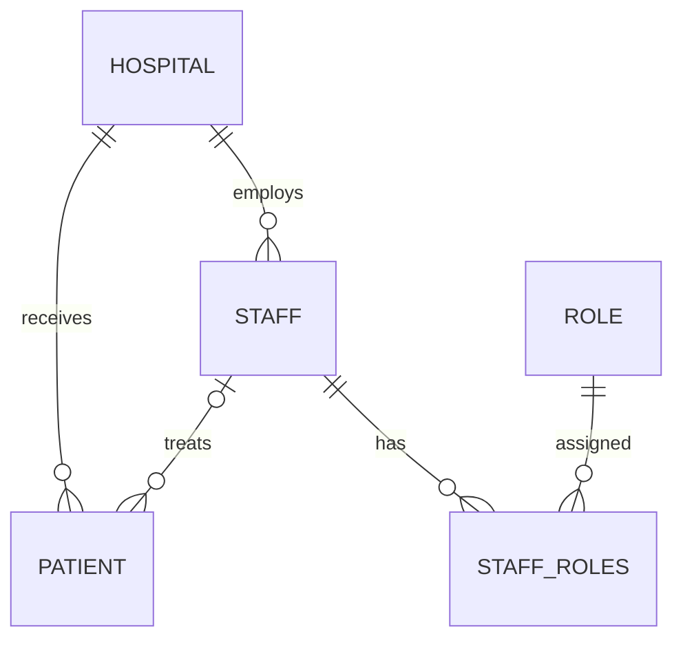

# Data model

SQLModel maps Python entities to MySQL tables. Create, read, and update schemas live beside each table model in `app/models/`. Integer primary keys are generated by the database.

| Model | Table | Main fields | Relationships |
| --- | --- | --- | --- |
| [Hospital](hospital.md) | `hospital` | id, name, location, capacity | Many staff and patients |
| [Patient](patient.md) | `patient` | id, first_name, last_name, date_of_birth, hospital_id, staff_id, image_blob | One hospital; optional staff |
| [Staff](staff.md) | `staff` | id, first_name, last_name, date_of_admission, last_check_in, salary, hospital_id | One hospital; many patients and roles |
| [Role](roles.md) | `role` | id, name, description, access_type | Many staff through `staff_roles` |
| StaffRoleLink | `staff_roles` | staff_id, role_id | Composite primary key and two foreign keys |

The API serializes staff roles as a `role_ids` list rather than embedding Role objects. Relationships are not recursively included in read responses.

The dashboard uses these same fields and relationships. There are no bed, department, admission-status, or queue columns. In Testing, an admission is a patient POST, a discharge removes the current patient record with DELETE, and a transfer updates hospital and clinician together with PATCH. See [Architecture](../architecture.md).

## Application metadata

`app_state` is separate from the domain model. Row 1 stores the boolean `was_initialized` flag used by `/initialization` to remember the startup choice across browsers and restarts. A missing row means false. Startup table creation adds this new table to an existing database without altering domain records.
