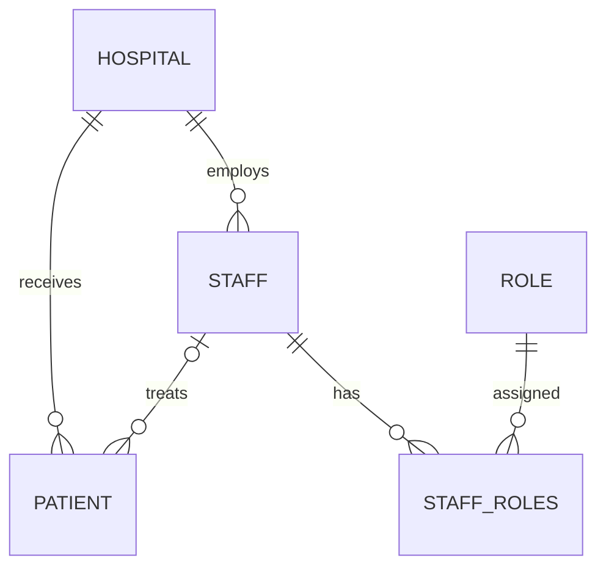

# Data model

SQLModel maps Python entities to MySQL tables. Create, read, and update schemas live beside each table model in `app/models/`. Integer primary keys are generated by the database.

| Model | Table | Main fields | Relationships |
| --- | --- | --- | --- |
| [Hospital](hospital.md) | `hospital` | id, name, location | Many staff and patients |
| [Patient](patient.md) | `patient` | id, first_name, last_name, date_of_birth, hospital_id, staff_id | One hospital; optional staff |
| [Staff](staff.md) | `staff` | id, first_name, last_name, hospital_id | One hospital; many patients and roles |
| [Role](roles.md) | `role` | id, name, description | Many staff through `staff_roles` |
| StaffRoleLink | `staff_roles` | staff_id, role_id | Composite primary key and two foreign keys |

The API serializes staff roles as a `role_ids` list rather than embedding Role objects. Relationships are not recursively included in read responses.

Browser departments, beds, queue statuses, and simulated stays are separate frontend concepts, not columns in this schema. See [Architecture](../architecture.md).
