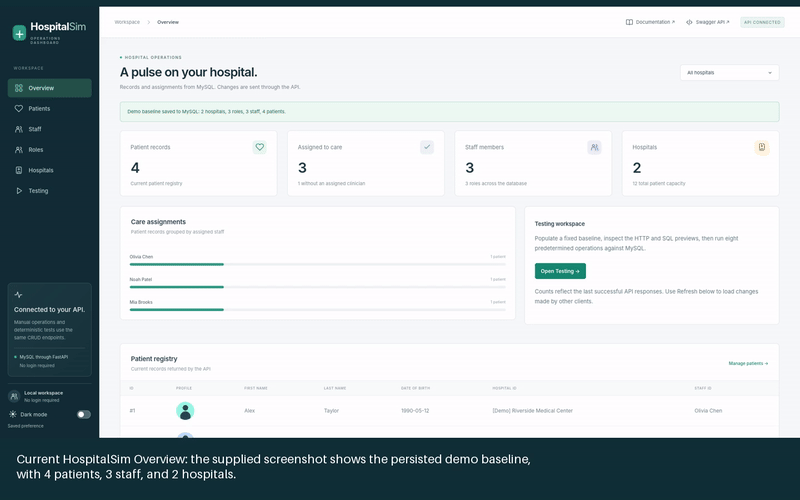

# Earlier interface walkthrough

This archived 30-second tour shows the earlier browser-only interface. The current dashboard uses the API and MySQL, and its Testing tab replaces those earlier controls. Follow the [current dashboard guide](../dashboard.md) for the current behavior. The original captures and timestamp-based renderer remain available below.

<video controls preload="metadata" width="100%" poster="overview.png">
  <source src="walkthrough.mp4" type="video/mp4">
  Your browser can download the video using the link below.
</video>

[Download MP4](walkthrough.mp4) · [Animated GIF](walkthrough.gif) · [Timeline JSON](timeline.json) · [Original screenshot](overview.png)

## Record the complete current dashboard

The [capture script](capture.py) drives the actual current dashboard through its UI and sends requests to the running API. It does not use a mock backend or fabricate screenshots. It requires a fresh, empty local instance and stops before making changes if existing records are found. During capture it creates and edits dedicated walkthrough records, demonstrates protected deletion, removes its temporary records in dependency order, populates the demo, and runs the predefined test. It leaves the final test state in MySQL.

Start the full stack locally. Install FFmpeg on your PATH, then run from the repository root:

```bash
uv run --with playwright --with pillow python -m playwright install chromium
uv run --with playwright --with pillow python docs/vid/capture.py --url http://localhost:3000
```

Use `--headed` to watch the browser. For Vite, pass `--url http://localhost:5173` with the API running on port 8080. To create a fresh instance with the existing helper, `bash run.sh -d` **deliberately deletes all project Compose volumes and records**; use it only for an instance whose data can be discarded.

The complete recording covers:

1. Welcome choices, initial read/SQL preview, empty Overview, and Test prerequisite popup.
2. Hospitals: create/edit name and location; Roles: create/edit names and descriptions.
3. Staff: create/edit names, hospital membership, and role checkboxes.
4. Patients: create/edit names, birth date, hospital, and optional clinician assignment.
5. HTTP/JSON and SQL confirmations, search, hospital filtering, single-record reads, and response JSON.
6. Protected parent deletion (409), then deleting temporary patients, staff, roles, and hospitals in order.
7. Populate preview, persisted baseline, and all four populated directories.
8. Test story, ordered requests, SQL modifications, pause/next-hour/speed/resume controls, and an actual running GIF.
9. Verified final patients, staff roles, and hospital location; Refresh and the documentation/Swagger links.
10. The bottom connection/profile area, the visible Dark mode switch, and returning to the browser theme. Sidebar navigation also verifies scrolling to the top.

On success, real screenshots go into `screens/`, the running capture into `clips/test-running.gif`, and a new `timeline.json` records timestamps, relative file paths, captions, and capture provenance. The script then stitches a new `walkthrough.mp4` and `walkthrough.gif` with the renderer. No updated recording is claimed until that capture succeeds; the video linked above remains the archived earlier interface until then.



## Media and timeline

All assets live in `docs/vid/`. The original is a genuine screenshot of the published dashboard. Detail images crop that capture, and the short GIFs zoom into those details. These camera movements do not represent changes to simulation state.

Each entry in `timeline.json` has a `timestamp` in seconds, a `file_path` relative to this folder, and a `caption`. An entry runs until the next timestamp; the final entry runs until `duration`. Animated GIFs play within their allotted interval. The source screenshot is also identified in the JSON.

## Rebuild the video

Install FFmpeg and make `ffmpeg` available on your PATH, then run from the repository root:

```bash
python -m pip install Pillow
python docs/vid/render.py
```

The renderer reads the JSON, stitches the referenced images and GIFs at their timestamps, adds captions, and writes `walkthrough.mp4` and `walkthrough.gif` in the same folder. It does not start or reset the application or database.

To change the sequence, edit the timestamps, captions, and file paths in the JSON and run the renderer again. The first timestamp must be zero and subsequent timestamps must increase strictly. Replace or add media files to include further captured views.
